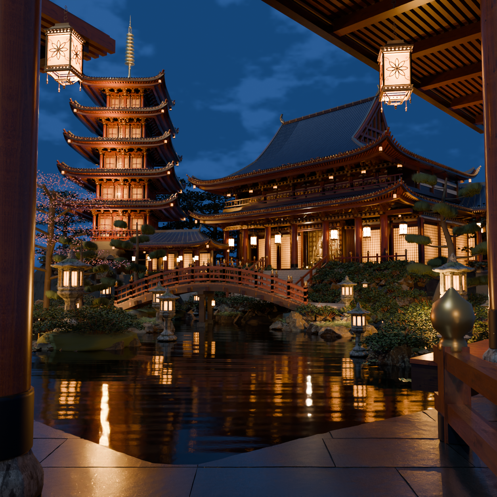

# Scene09 physical night-court review

R05 is a held Cycles candidate from the actual frozen R10 scene. Thin washi transport, calibrated existing fixtures, multiple-bounce light, physical pond water and wet granite now produce warm courtyard reflections and readable stone/timber surfaces. The source camera and architecture remain fixed. **`visualAccepted:false`**: this physical rendering is still visibly different from the supplied photograph.

Review the [unaltered reference/Cycles comparison](reference-left-cycles-right-r05.png), [native wet-floor detail](cycles-r05/floor-native.png), [native architectural detail](cycles-r05/architecture-native.png), [render report](cycles-r05/report.json), and [file/hash manifest](review-manifest.json). The full image is1254×1254 at128 samples. Details are fresh96-sample Cycles ray renders using a2508×2508 full sensor and render borders:2257×677 floor and1529×828 architecture. No image is enlarged to create detail evidence.

The editable release asset is [the packed R05 Blender model](cycles-r05/scene09-r10-packed-physical-r05.blend), with the full reference camera and packed material/sky images. [Scene-linear RGB radiance](cycles-r05/scene09-r10-physical-r05-linear.exr) is retained for grading. Large `.blend`/EXR files remain local release assets rather than Git blobs; exact size and SHA-256 are in the report/manifest. Code, asset provenance, comparisons and actual render evidence stay in this folder.

Source identity is commit `a10b118a2b09e65e9bfad6b64c6016299c59bf41`, SHA-256 `b2d659097d51b2a49b720f3ff83a6bdf84e6c265dd2a89225e5c8ba074637715`. The parent’s [verified export](export/export-report.json) contains501,594 source instances and51,311,767 indexed triangles. R05 retains every source indexed triangle. Orthogonal instances remain linked,36,607 sheared instances preserve full affine geometry, and three rank2 flattened boxes retain their original36 indexed triangles with recalculated planar normals. [The area audit](singular-source-area-audit.json) explicitly corrects the earlier importer’s zero-area assumption; R01–R04 receipts remain unchanged as failed-candidate evidence.

| Candidate | Actual rendered change | Review finding |
| --- | --- | --- |
| [R01](cycles-r01/scene09-r10-physical-r01.png) | Exact source PBR/instance transfer, source-code cloudy sky, physical water | Opaque paper traps lamp transport; eaves too dark |
| [R02](cycles-r02/scene09-r10-physical-r02.png) | Thin washi scattering, pane radiance, physical ripple/chop | Actual warm reflected panes appear; capitals still underlit |
| [R03](cycles-r03/scene09-r10-physical-r03.png) | Existing point/spot flux and emissive spectral calibration | Carpentry opens up; room panes and smooth granite need correction |
| [R04](cycles-r04/scene09-r10-physical-r04.png) | Facet-following IOR1.333 granite film, scan roughness, metric microrelief | Native floor shows broken grain highlights; broad room overglow remains |
| [R05](cycles-r05/scene09-r10-physical-r05.png) | Room/pagoda pane balance and complete singular-geometry restoration | Held physical review candidate; photographic fidelity unaccepted |

All67 source points, four spots, moon and warm fill retain their source anchors/directions. Point flux uses a numerical `4π` transfer then gain4; spots use gain1.5; moon/fill gains remain1. Spectral efficacy is unknown, so these are declared radiant calibration values, not recovered photometry. Source emissive RGB still multiplies the material-space washi map before an explicit `[1,1.5,1.2]` calibration. Small lantern radiance is retained while R05 lowers broad room panes0.45 and pagoda panes0.70 relative to R04. The photographic output uses AgX exposure+0.20 stops, camera sky gain0.827 and actual multi-bounce GI. No extra courtyard lights were added.

The52×55m pond lies at the native source elevationY−0.02. IOR1.333 water reflects the modeled geometry, fixtures and sky through actual Cycles paths, with millimetre world-space waves and uncolored chop. Every closed source granite slab, cut edge, foundation and plinth is unchanged. Its water film follows source facet/scan normals plus authored0.9mm and0.35mm riven/mineral microrelief; film roughness is `0.015 + 0.07 × CC0 scan roughness`. There is no floating floor mirror, reference-photo projection, replacement scene plate, or painted reflection stroke. The sky contains only the frozen source’s code-generated cloud field.

The final full image and both native details were inspected. Granite highlights now break over mineral/riven normals, the slab joints and plinth contact remain readable, and physical warm transport reaches the connected capitals. The reference has different roof/facade proportions, richer carved openings, less regular carpentry, a different bridge/bank relationship and denser organic planting. The frozen source's repeated panes and simplified garden forms remain visible; its upper-gallery recesses are still darker than the reference. Cycles also differs from native Three.js in tone mapping, thin-paper transport, all-light physical occlusion, native finite cutoffs, custom GLSL materials, probe reflections, hemisphere lighting and fog. The three rank2 instances need a declared normal replacement because the source inverse-transpose is undefined. These limits prevent a pixel-equivalence or photograph-match claim.

See [provenance](provenance.json) and [reproduction/calibration instructions](REPRODUCING.md). Every 3D render used `tools/run-blender-queued.mjs` and the shared GPU mutex. The canonical Scene09 runtime/assets and other scenes were not edited by this lane.
