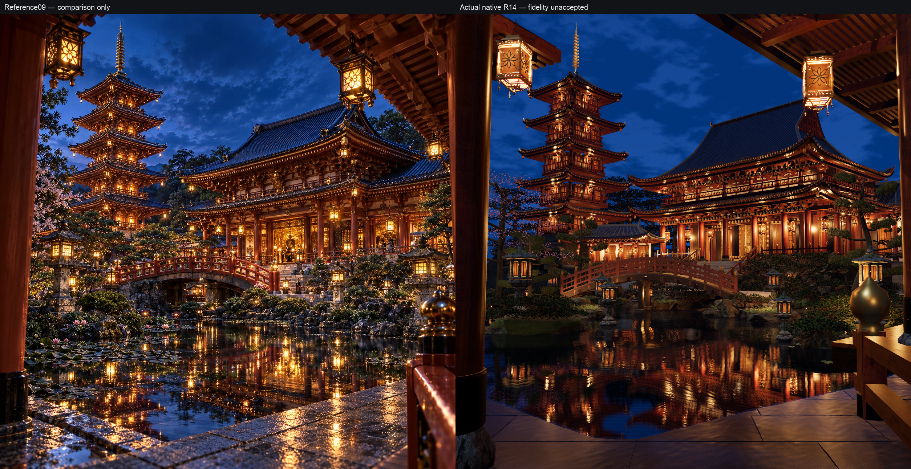

# Scene09 R14 held native architectural checkpoint

Held source SHA-256: `a9e7fe2dfe50c8d5c01d9a694c873cbd9f8ca7477275bf5c6390873e0b078b5a`. Capture base commit: `acba26a7c9eba1d3a138b7ce7347e8f7f812db75`; the source changes are uncommitted for parent integration. All48 source-file hashes match the retained captures. **`visualAccepted:false`**. This is substantive geometry progress, with remaining photographic differences.

The broad luminous window wall is replaced with actual open front/return room volumes. Side front portals have3.90m/4.05m framed spans and2.25m depth,0.67m side lights, folded solid shutters, capped jamb/ceiling/threshold returns and carved back furnishings. The main seated figure is repositioned and scaled against the threshold, supported by a floor-contacting plinth; a secondary shrine sits inside the right chamber. These are geometric enclosures and furnishings, not projected room images.

The oblique R13 view exposed broad flat side infill and sparse returns. R14 rebuilds the return as two gallery levels. Lower enclosure x±7.15 and upper infill x±6.85 sit behind a common structural row at x±8.10 and railing at x±9.10. Lower capitals seat the upper floor at localY7.93; continuous beams and transverse joists carry its edge. Independent upper posts/capitals and continuous receiver beams meet the same analytical roof used by the shell builder. Opaque upper cream panels are short recessed fields between real framing, replacing continuous side bands.

Main roof and capital bearings now share `hall-envelope143.js`: a smaller gable shoulder, compact ridge ornaments and measured ridge endpoints change the real closed roof shell and its framing together. The pagoda is rebuilt as a returning square structure, with yaw1.05, common3.03m storey pitch, narrower roof taper, shorter framed walls and a steeper top pyramid. The finial retains a continuous spindle with eleven thin closed annular rims and actual air gaps. Twenty modeled hanging fixtures on the returning faces replace the five old free point pools; their local flux is reduced after R12 exposed close-beam overglow.

The common reference camera remains `[6,2.7,33]` looking at `[0,5.5,-10]`, FOV52. Floor, pond, near rail/supports and the low seven-second shot path remain unchanged. Manual image landmarks constrain a common3D construction: ten coarse pagoda eave endpoint residuals improve from mean35.6px to6.8px; top-roof apex and finial tip residuals are3.2px and1.3px. [Measurements and uncertainty](landmark-measurements.json) are silhouette constraints, not acceptance metrics or a view-dependent warp.

Actual evidence, inspected at the held hash:

- [Full1254 native frame](../iteration-scene09-solmax-bearing-return-gallery-r14-20261021/reference.png) and [true native facade detail](../iteration-scene09-solmax-bearing-return-gallery-r14-20261021/detail-native.png), independently sampled subfrustum from a2508 sensor.
- [Oblique1254 construction view](../iteration-scene09-solmax-bearing-return-oblique-r14-20261021/inspection-view.png), exposing room depth, return columns, joists, floor contact and roof bearings.
- [Three native shot poses](three-native-shot-poses-r14.png), at0/3.5/7 seconds, each960square.
- [R10/R14 native comparison](baseline-left-r14-right.png), [exact source/render manifest](review-manifest-r14.json), and [retained source text/hash archive](retained-source/source-manifest.json).

All six native frames report GL0, linked shaders and no resource/render errors. These checks establish successful rendering; they do not establish photographic fidelity. Every3D job used `tools/render-one-reconstruction.mjs` and the shared GPU mutex. R11–R13 images/receipts remain in their iteration directories, including the failed thick-rim and broad side-wall candidates.

The reference still has finer and less regular carpentry, different near roof/overhang proportions, richer sanctuary carving, less geometric planting, and more complex wet-floor/pond detail. The main upper roof remains broader/steeper in parts of its visible near profile than the reference. Native close lights retain strong local highlights. The unchanged0s opening pose exposes the existing finite pond perimeter at the far right; this is visible in the pose evidence and needs the parent film-camera review. No full new seven-second clip is claimed here. The held Cycles R05 study remains immutable at its older D-source `b2d659…` and was not updated or relabeled as current runtime geometry.

No reference scene pixels, photo depth, replacement plate or painted reflection was introduced. New construction provenance is in `reconstructions/scene-09/assets/open-sanctuary143/provenance.json`; existing declared CC0 surfaces and actual courtyard reflection systems remain in use. No other scene, shared asset, global film file or Git commit was changed by this lane.
